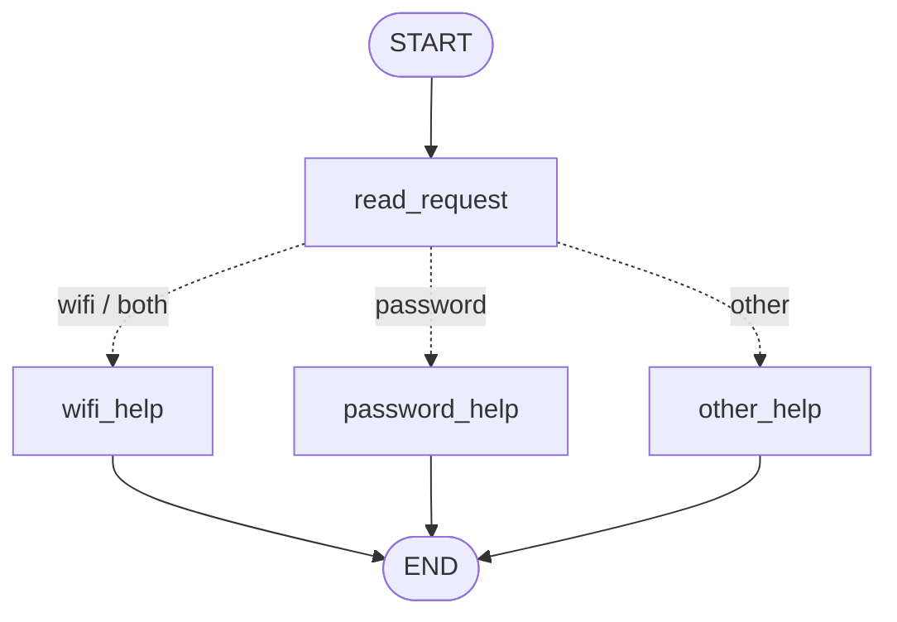
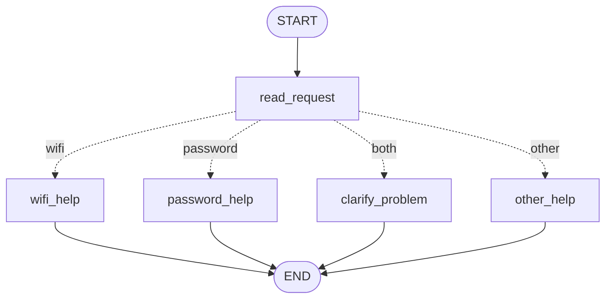
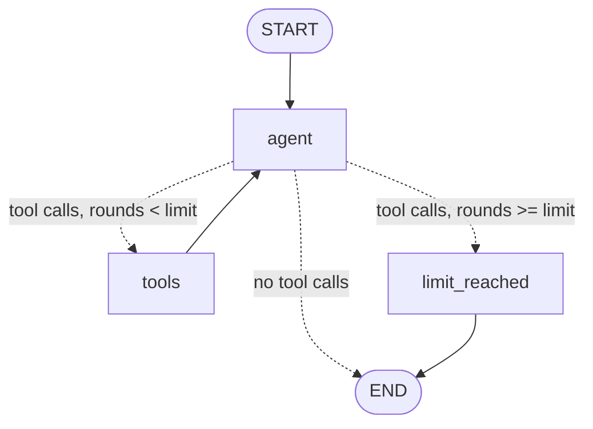

# HW5 — My LangGraph helpdesk

## Part 1 — How the graph works

### My graph and state

Code: `helpdesk/part1_graph.py`. Run: `python run_part1.py` (add `--draw` to print the graphs as Mermaid).



State (`HelpdeskState`):

| Field | What it holds | Written by |
| --- | --- | --- |
| `message` | The user's original message | input |
| `category` | `wifi`, `password`, `both` or `other` | `read_request` |
| `reply` | The answer for the user | a help node |

What each node reads and changes:

| Node | Reads | Changes |
| --- | --- | --- |
| `read_request` | `message` | `category` |
| `wifi_help` | nothing from state (reads `data/helpdesk.json`) | `reply` |
| `password_help` | nothing from state (reads `data/helpdesk.json`) | `reply` |
| `other_help` | nothing | `reply` |
| router `route_original` (conditional edge) | `category` | nothing — it only returns the name of the next node |

**1. What does each node read and change?** See the table above. Only `read_request` looks at the message. The help nodes only write `reply`.

**2. Node update vs conditional edge.** A node returns a dict, for example `{"category": "wifi"}`. LangGraph merges this dict into the state. A conditional edge does not change the state. It is a function that reads the state and returns a node name, for example `"wifi_help"`. Then LangGraph runs that node.

**3. What does the next node receive?** It receives the full current state, not only the last update. For example, after `read_request` the help node gets `{message, category}`. The `message` is still there. My trace in `outputs/part1/` shows this: `state_after` keeps all old fields.

**4. START, END and compile.** `START` is the entry point: the first edge goes from `START` to `read_request`. `END` means the run stops and the final state is returned. `compile()` checks the graph (all nodes exist, edges are correct) and makes a runnable object with `.invoke()` and `.stream()`.

### Predictions before running

My rule order: Wi-Fi is checked first, then password, then other.

| Message | Predicted route | Actual route | What I learned |
| --- | --- | --- | --- |
| I cannot connect to Wi-Fi. | read_request → wifi_help | read_request → wifi_help | `wi-fi` is found after `.lower()` |
| I forgot my PASSWORD. | read_request → password_help | read_request → password_help | Upper case works because I use `.lower()` |
| My laptop screen is broken. | read_request → other_help | read_request → other_help | No keyword → fallback node asks Wi-Fi or password |
| My Wi-Fi password does not work. | read_request → wifi_help | read_request → wifi_help | Both words appear. The Wi-Fi rule is checked first, so the password part is ignored. |

Logs: `outputs/part1/predictions_original.json`, `outputs/part1/S01.json` … `S04.json`.

**Two topics.** In `My Wi-Fi password does not work.`, `read_request` sets `category = "both"`. The original router checks Wi-Fi first (`if category in ("wifi", "both")`), so it goes to `wifi_help`. The user gets Wi-Fi steps, but maybe the real problem is the Wi-Fi password. This is the weak point of the original rules.

### My change to the graph

I added the node `clarify_problem` and a new router `route_with_clarification`. Build it with `build_graph("with_clarification")`.



New trace for `My Wi-Fi password does not work.` (`outputs/part1/S05.json`):

```
START -> read_request -> clarify_problem -> END
after read_request:    {message: "My Wi-Fi password does not work.", category: "both"}
after clarify_problem: {..., reply: "Your message mentions both Wi-Fi and a password. Which problem do you want to solve first: Wi-Fi or password?"}
```

The other three messages keep the same routes (`outputs/part1/runs_with_clarification.json`).

**What LangGraph controls:** the order of running nodes, starting at `START` and stopping at `END`, calling the router after `read_request`, merging each node's update into the shared state, and passing the state to the next node.

**What my Python functions decide:** how to find the topic (keyword search, case-insensitive), which node is next (the `if` rules in the router), and the text of each reply. There is no model in Part 1. All decisions are my fixed rules, so the same message always gives the same route.

## Part 2 — Model and tools

Code: `helpdesk/tools.py` (tools), `helpdesk/agent.py` (graph), `run_part2.py` (runner).

**Model and provider:** `gpt-5.6-luna`, OpenAI (Chat Completions API), through the `langchain-openai` adapter, with `reasoning_effort=none`.

Why `reasoning_effort=none`: my first run failed with error 400. OpenAI said that this reasoning model cannot use function tools in `/v1/chat/completions` unless `reasoning_effort` is `none`. I added the `REASONING_EFFORT` setting to `.env`. Reasoning models do not accept a custom temperature, so the code does not send `temperature` when this setting is used.

### The model/tool loop



1. `agent` node: the **model** reads the messages and returns an `AIMessage`. This message has either `tool_calls` (a request) or normal text (the answer).
2. `route_after_agent` (conditional edge): looks at the last message.
3. `tools` node: **my program** runs the requested Python functions and adds a `ToolMessage` with each result.
4. Back to `agent`. The model now sees the result and decides again.

### Three tools

| Tool | Reads | Does |
| --- | --- | --- |
| `find_instructions(topic)` | `data/helpdesk.json` | Returns the title, steps and `instruction_id` for `wifi` or `password` |
| `check_service_status(topic)` | `data/service_status.json`, selected snapshot | `wifi` → service `wifi`, `password` → `account_recovery`. Returns `operational`, `outage` or `unknown` |
| `prepare_ticket(summary, steps_tried, category, service_status, reference_ids)` | `data/ticket_template.json` | Saves a **local** draft `outputs/tickets/TKT-<thread>-NNN.json`. Refuses if the problem or the steps are missing. Never sends anything |

The model chooses only the topic and the ticket text. The **application** sets `user_id`, `thread_id` and the status snapshot (`SessionContext`). The model cannot change them.

**Direct calls without the agent:** `python run_part2.py --direct` → `outputs/part2/direct_tool_calls.json`. Each tool has a plain function (`find_instructions_impl`, `check_service_status_impl`, `prepare_ticket_impl`). The model-facing tools only wrap these functions.

### Loop limit

`MAX_TOOL_ROUNDS = 5` (setting in `.env`). The state field `tool_rounds` starts at 0 for every user message, and the `tools` node adds 1 each time it runs. The limit is checked in the conditional edge `route_after_agent`: if the model asks for a tool again and `tool_rounds >= 5`, the graph goes to `limit_reached` instead of `tools`. That node closes the open tool calls, writes a short message and goes to `END`. The log field `loop_limit_reached` shows if this happened. Test: `test_loop_limit_stops_endless_tool_calls`.

### Answers

**1. How does the graph decide between running a tool and ending?** The conditional edge `route_after_agent` reads the last message. If it has `tool_calls` → `tools` (or `limit_reached`). If it has no tool calls → `END`. The model decides *what* to write; my edge function turns that into the next node.

**2. Who requests a tool and who executes it?** The **model** only requests: it returns the tool name and arguments in `tool_calls`. The model never runs code. **My program** executes: the `tools` node (LangGraph `ToolNode`) calls my Python function and returns the result.

**3. What changes in the state after a tool result returns?** A `ToolMessage` with the result (JSON) is appended to `messages` (the `add_messages` reducer adds, it does not replace). `tool_rounds` grows by 1. On the next `agent` step the model sees the result.

**4. How is this different from Part 1?** In Part 1 the route is fixed by my `if` rules on keywords, so it is always the same. In Part 2 the **model** chooses the tools from the meaning of the message and from earlier tool results, and the graph has a **loop** (`tools → agent`). The same request can follow different paths when the data is different.

### Actual run with several tools (S06, second message)

Command: `python run_part2.py` → `outputs/part2/S06.json`. Second message:

```
USER: I enabled Wi-Fi and forgot the saved network, but Campus-Demo still will not connect.
      Check whether Wi-Fi is down. If it is operating, prepare a ticket about this problem.
[agent] model requests check_service_status({'topic': 'wifi'})
[agent] model requests find_instructions({'topic': 'wifi'})
[tools] check_service_status -> status "operational"
[tools] find_instructions    -> GUIDE-WIFI
[agent] model requests prepare_ticket({'summary': 'Campus-Demo will not connect even after Wi-Fi
        was enabled and the saved network was forgotten.', 'steps_tried': ['Enabled Wi-Fi',
        'Forgot the saved network'], 'category': 'wifi', 'service_status': 'operational',
        'reference_ids': ['GUIDE-WIFI']})
[tools] prepare_ticket -> created TKT-s06-001, sent: false
HELPDESK: Wi-Fi is operational with no reported outage. I prepared a local ticket draft ...
          It was not sent. File: outputs/tickets/TKT-s06-001.json
```

Route: `agent → tools → agent → tools → agent → END` (2 tool rounds, limit not reached).

What I see: the model asked for **two tools in one round** (status and instructions), and my `tools` node ran both. It called `prepare_ticket` only **after** it saw `operational`. The `steps_tried` are only the steps the user said. The ticket file is `outputs/tickets/TKT-s06-001.json`.

### Same request, different snapshots

| Scenario | Snapshot | Tools used | Result |
| --- | --- | --- | --- |
| S06 | normal | check_service_status, find_instructions, prepare_ticket | Status operational → ticket `TKT-s06-001` was made |
| S07 | wifi_outage | find_instructions, check_service_status | Status outage → no ticket. The model said the condition was not met and no repair time is given |
| S08 | status_unavailable | check_service_status, find_instructions | Status unknown → no ticket. The model said it is not confirmed up or down and asked if I want a ticket saying the status could not be checked |

Expected: `operational` → ticket draft. `outage` → no ticket, the condition was not met. `unknown` → no ticket, the assistant asks whether to make one saying the status could not be checked.

## Part 3 — Memory

TODO: explain conversation state, thread_id, user identifier, user preference storage, and retrieval from helpdesk.json.

| Situation | Command used | Log file | What happened |
| --- | --- | --- | --- |
| Refer to an earlier message | | | |
| Close, restart and resume | | | |
| Same user, new conversation | | | |
| Different user | | | |

## Part 4 — Running and checking my work

TODO: point to the README setup steps, package versions, memory-reset instructions, tests and GitHub Actions workflow. Explain which mistake each test catches and which runs use a fake model.

## Choices and limitations

TODO: explain the storage and libraries I chose, why they fit this task, and what still does not work reliably.

## Supplied scenarios — my actual results

| Scenario | Command or manual steps | Log file | What happened / what I changed |
| --- | --- | --- | --- |
| S01 — Simple Wi-Fi route | `python run_part1.py` | `outputs/part1/S01.json` | read_request → wifi_help. Category `wifi`, reply from GUIDE-WIFI. Matches my prediction |
| S02 — Case-insensitive password route | `python run_part1.py` | `outputs/part1/S02.json` | read_request → password_help. `PASSWORD` works because of `.lower()` |
| S03 — Unsupported request | `python run_part1.py` | `outputs/part1/S03.json` | read_request → other_help. It asks: Wi-Fi or password? |
| S04 — Two topics before the graph change | `python run_part1.py` (original graph) | `outputs/part1/S04.json` | Category `both`, but route → wifi_help, because the Wi-Fi rule is checked first. The password part is lost |
| S05 — Two topics after adding clarification | `python run_part1.py` (with_clarification graph) | `outputs/part1/S05.json` | read_request → clarify_problem. It asks which problem to solve first. I changed the router |
| S06 — Instructions then local ticket | `python run_part2.py --scenario S06` | `outputs/part2/S06.json`, `outputs/tickets/TKT-s06-001.json` | Turn 1: find_instructions. Turn 2: check_service_status (operational) → prepare_ticket. Draft saved, not sent |
| S07 — The same request during a Wi-Fi outage | `python run_part2.py --scenario S07` | `outputs/part2/S07.json` | check_service_status → outage. No ticket, no repair time invented |
| S08 — Status source unavailable | `python run_part2.py --scenario S08` | `outputs/part2/S08.json` | Status unknown. No ticket. Asks if I want a ticket saying the status could not be checked |
| S09 — Missing ticket details | `python run_part2.py --scenario S09` | `outputs/part2/S09.json`, `outputs/tickets/TKT-s09-001.json` | Turn 1: no tools, asks for the problem and steps. Turn 2: ticket with only the user's steps. The model also checked status (not asked, but it is recorded as operational) |
| S10 — Use the current conversation | | | |
| S11 — Persist and recall after restart | | | |
| S12 — Preference across threads without replay | | | |
| S13 — Do not share memory between users | | | |
| S14 — Password recovery outage | `python run_part2.py --scenario S14` | `outputs/part2/S14.json` | password → `account_recovery` service → outage. No repair time invented |